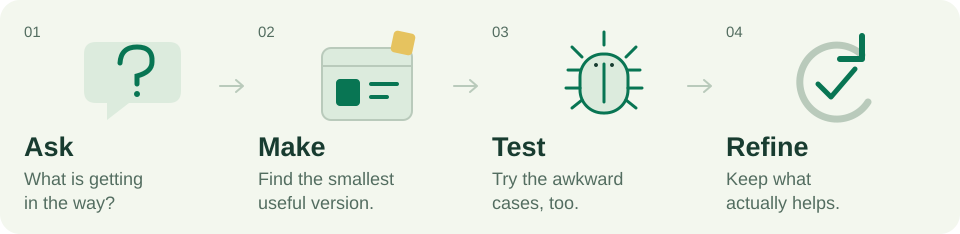

<picture>
  <source media="(max-width: 600px) and (prefers-color-scheme: dark)" srcset="assets/fos-pixel-dark-mobile.svg">
  <source media="(max-width: 600px)" srcset="assets/fos-pixel-light-mobile.svg">
  <source media="(prefers-color-scheme: dark)" srcset="assets/fos-pixel-dark.svg">
  
</picture>

# Hey, I'm Fernando 👋

**I solve real problems with technology.**

I work across **apps, automation, websites, subtitles, and translation**.

## The loop

<picture>
  <source media="(max-width: 600px) and (prefers-color-scheme: dark)" srcset="assets/work-loop-dark-mobile.svg">
  <source media="(max-width: 600px)" srcset="assets/work-loop-light-mobile.svg">
  <source media="(prefers-color-scheme: dark)" srcset="assets/work-loop-dark.svg">
  
</picture>

## Under the hood

<b>Open the toolbox</b>

- **Flutter & Dart**: interfaces, state, and application structure.
- **Testing & architecture**: clear boundaries, edge cases, and behavior that holds up as things change.
- **Automation & AI**: connect steps, reduce manual work, and check the output.

