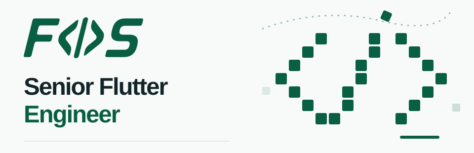

<picture>
  <source media="(prefers-color-scheme: dark)" srcset="assets/fos-pixel-dark.svg">
  
</picture>

# Hey, I'm Fernando 👋

I'm a Senior Flutter Engineer focused on architecture, resilient tests, and software that's easier to evolve.

## What I care about

- Flutter and Dart
- Domain modeling and clear architectural boundaries
- Tests that check meaningful behavior
- Automation and AI-assisted development

Happy paths are only half the story.
