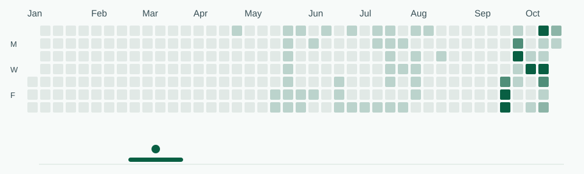

<picture>
  <source media="(prefers-color-scheme: dark)" srcset="assets/fos-pixel-dark.svg">
  
</picture>

# Hey, I'm Fernando 👋

I'm a Senior Flutter Engineer focused on architecture, resilient tests, and software that's easier to evolve.

## What I care about

- Flutter and Dart
- Domain modeling and clear architectural boundaries
- Tests that check meaningful behavior
- Automation and AI-assisted development

<picture>
  <source media="(prefers-color-scheme: dark)" srcset="assets/breakout-dark.svg">
  
</picture>

Publicly visible contribution calendar · snapshot 2026-10-12 · decorative ball, real contribution levels.

Happy paths are only half the story.

[LinkedIn](https://www.linkedin.com/in/fernando-de-oliveira-santos/)
