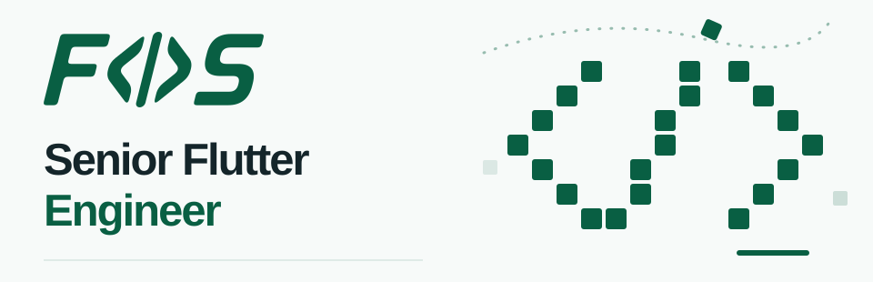

<picture>
  <source media="(prefers-color-scheme: dark)" srcset="assets/fos-pixel-dark.svg">
  
</picture>

# Fernando

This is the GitHub profile of Fernando de Oliveira Santos, a senior Flutter engineer, for people who have not seen his work before.

## What he can do

- Build Flutter and Dart apps
- Define what the software is about before building the interface
- Keep the parts of a system clearly separated
- Test behavior that matters when something goes wrong
- Automate repeated work and use AI-assisted development

## Setup

1. Open [github.com/fernando-s97](https://github.com/fernando-s97).

| Requirement | Detail |
| --- | --- |
| Install | None. This repository is the profile page, not a package. |
| Account | None. The profile is public. |
